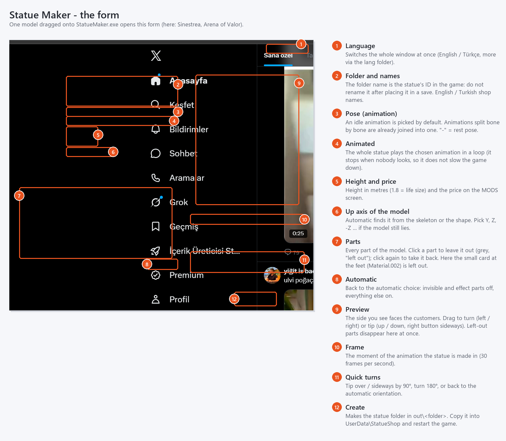
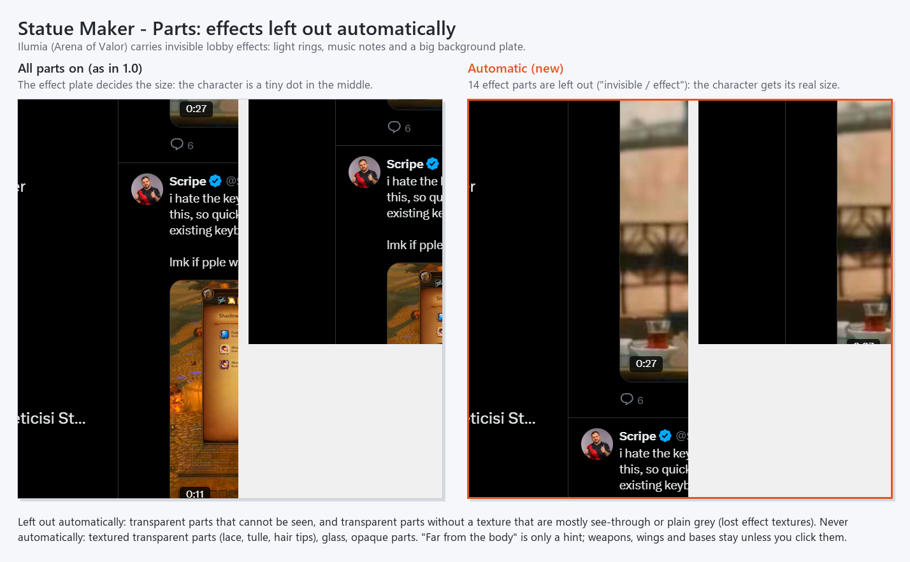
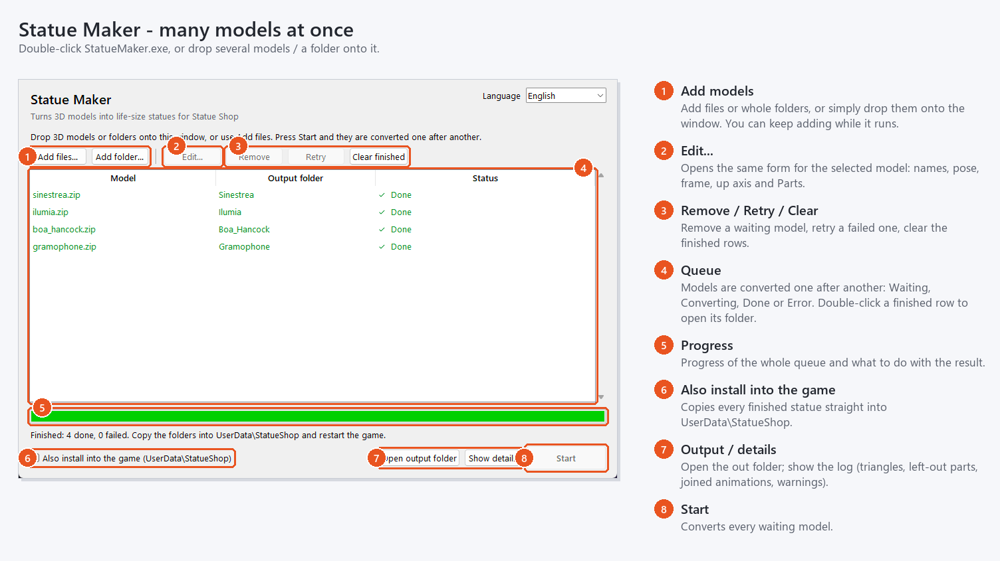
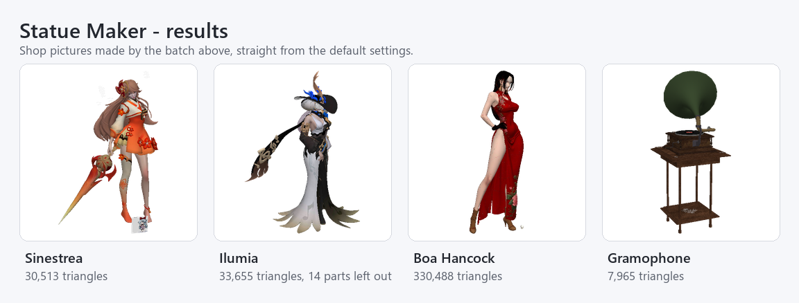
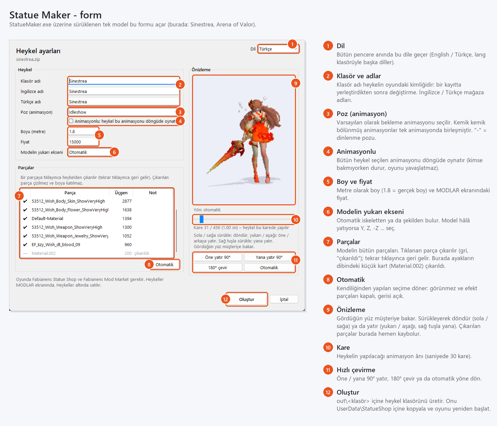
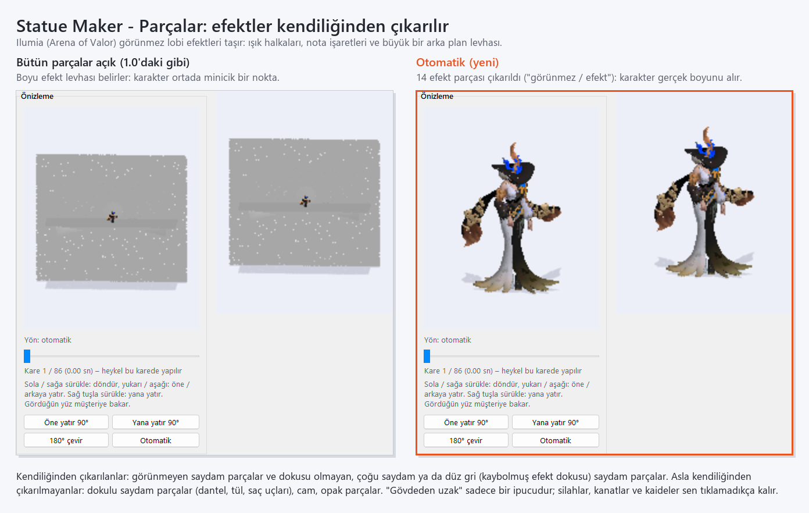
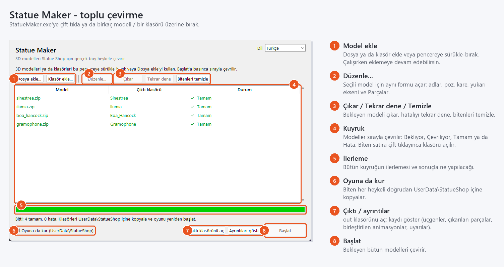

# Statue Maker for Anime Shop Simulator

Turn any 3D model (GLB, GLTF, Sketchfab zip, FBX, OBJ, BLEND) into a **life-size statue** for the **Statue Shop** mod of
Anime Shop Simulator. Buy it on the MODS screen and place it in your shop like any other statue - frozen in the pose you
pick, or playing its animation in a loop. Windows only. Made by **Fabianens**.

This repository holds both halves: the **Statue Maker** app (Python) and the source of the **Statue Shop** MelonLoader
mod that loads the statues in the game (`StatueShop/`, C#). Its sister project for shelf figures is
[Figure Maker](https://github.com/universesofcyberpunk/anime-shop-simulator-figure-maker).

- [Screenshots](#screenshots)
- [Install the ready exe](#install-the-ready-exe)
- [Run from source](#run-from-source)
- [Build the exe yourself](#build-the-exe-yourself)
- [Statue Shop mod (source)](#statue-shop-mod-source)
- [How to use (full guide, English + Türkçe)](#english)

## Screenshots

**The form** - one model dragged onto StatueMaker.exe. Numbers explain every control.



**Parts** - invisible effect parts (light rings, music notes, background plates in game models) are left out automatically, so the statue gets its real size. Click any part to leave it out yourself.



**Batch window** - many models at once, one after another.



**Results** - shop pictures from the batch above, default settings.



<details>
<summary>Ekran görüntüleri (Türkçe)</summary>






</details>

## Install the ready exe

1. Download **StatueMaker.exe** from the [Releases](../../releases) page.
2. Put it in a folder you can write to, e.g. `Desktop\StatueMaker` (results are written next to the exe; Program Files does not work).
3. Drag a model onto `StatueMaker.exe`, or double-click it for the batch window.
4. Copy the folder from `out\<name>` into the game's `UserData\StatueShop` folder and restart the game.

In the game you need MelonLoader 0.7.x, **Statue Shop 1.0.0+** (source in [`StatueShop/`](StatueShop)) and **[Fabianens Mod Market](https://github.com/universesofcyberpunk/anime-shop-simulator-mod-market) 1.4.0+**.
FBX / OBJ / BLEND input also needs [Blender 4.x](https://www.blender.org/download/) installed (GLB, GLTF and zip need nothing).
If Windows SmartScreen warns, click *More info > Run anyway* (the exe is not signed).

## Run from source

Needs **Python 3.10 or newer (64-bit)** on Windows.

```bat
git clone https://github.com/universesofcyberpunk/anime-shop-simulator-statue-maker-.git
cd anime-shop-simulator-statue-maker-
python -m venv .venv
.venv\Scripts\activate
pip install -r requirements.txt

python statuemaker.py                          :: batch window (drag and drop, many models)
python statuemaker.py model.glb                :: one model, opens the form with the 3D preview and the Parts list
python statuemaker.py model.glb --no-form --install   :: no window, copies straight into UserData\StatueShop
```

`StatueMaker.bat model.glb` does the same as the second line (drag a model onto the .bat).
When run from source the tool finds the game in the usual Steam folder; `--install` copies the result there.
`etcpak` is optional: without it the textures stay PNG / JPG (the game reads those too, BC7 just uses less video memory).

## Build the exe yourself

```bat
.venv\Scripts\activate
pip install pyinstaller
pyinstaller --noconfirm StatueMaker.spec
```

The single-file exe is written to `dist\StatueMaker.exe`. Use a clean venv (only `requirements.txt` + PyInstaller)
so the exe stays small. The spec bundles `etcpak` together with the `archspec` data it needs to pick its CPU build;
without that the exe silently falls back to PNG / JPG textures. `tools\` is bundled inside the exe; `lang\`, `out\`,
`work\` and `settings.json` are created next to the exe on first use and are not part of the repository.

## Statue Shop mod (source)

`StatueShop/` is the in-game half: a MelonLoader 0.7.x mod (net6.0, IL2CPP) that reads every statue folder in
`UserData\StatueShop` (`statue.json` + `model.statue`, plus `model.skin` for animated statues), registers each one as a
statue on the **[Fabianens Mod Market](https://github.com/universesofcyberpunk/anime-shop-simulator-mod-market)** MODS screen (category Statues) and builds it in the shop. Every statue gets fixed IDs from
its folder name and its own on/off switch in the F10 Mod Settings menu.

1. Install the [.NET 6 SDK or newer](https://dotnet.microsoft.com/download) and run the game once with MelonLoader 0.7.x
   (that generates `MelonLoader\Il2CppAssemblies`, which the project references).
2. Build:

```bat
cd StatueShop
dotnet build -c Release
:: game not in the default Steam folder?
dotnet build -c Release -p:GameDir="D:\Games\Anime Shop Simulator"
```

The DLL is copied to the game's `Mods` folder. Close the game first, the file is locked while it runs.
The game's own DLLs are not in this repository; they come from your install.

| File | What it is |
|---|---|
| `StatueShop/StatueShop.cs` | mod entry, folder scan, `statue.json`, IDs, MODS screen registration, still model (`model.statue`) and animated model (`model.skin`) loaders |
| `StatueShop/StatueBuildQueue.cs` | builds statues one after another with a short gap instead of all in the same frame, so loading does not freeze |
| `StatueShop/Bc7Tex.cs` | loads the `.bc7` textures straight to the graphics card |

## Repository layout

| Path | What it is |
|---|---|
| `statuemaker.py` | the app: batch window, form with 3D preview and Parts list, conversion, icons, language files |
| `tools/conv.py` | glTF reader and converter to the game formats (`model.statue`, `model.skin`, textures); part filter, split-animation join, up-axis detection |
| `tools/standalone.py` | built-in icon renderer and facing detection (no Blender needed) |
| `tools/orient.py` | point-cloud preview used by the form |
| `tools/bc7.py` | BC7 texture compression (`.bc7` next to each texture) |
| `tools/fbx2glb.py` | runs inside Blender to turn FBX / OBJ / BLEND into GLB |
| `tools/gl.py`, `tools/rd.py` | glTF math helpers, model reader |
| `StatueMaker.spec` | PyInstaller recipe for the exe |
| `StatueShop/` | source of the Statue Shop mod that loads the statues in the game |

Only share statues of models whose licence allows it; the tool copies the model's credits into `license.txt`.
Code licence (Statue Maker and Statue Shop): MIT, see `LICENSE`. If you reuse the code, credit **Fabianens**.

## More by Fabianens

| Project | What it does | Links |
|---|---|---|
| **Statue Maker + Statue Shop** (this repository) | turn any 3D model into a life-size shop statue (app) and the mod that sells it | [GitHub](https://github.com/universesofcyberpunk/anime-shop-simulator-statue-maker-) |
| **Figure Maker + FigureShop** | turn any 3D model into a shop figure (app) and the mod that sells it | [GitHub](https://github.com/universesofcyberpunk/anime-shop-simulator-figure-maker) · [Nexus](https://www.nexusmods.com/animeshopsimulator/mods/82) |
| **Fabianens Mod Market** | MODS screen on the shop computer; API for other mods to list their items | [GitHub](https://github.com/universesofcyberpunk/anime-shop-simulator-mod-market) · [Nexus](https://www.nexusmods.com/animeshopsimulator/mods/31) |
| **Mod Manager** | build / test / package / publish state of all your mods (tool for modders) | [GitHub](https://github.com/universesofcyberpunk/anime-shop-simulator-mod-manager) |
| **Video TV** | wall TVs that play your own videos | [GitHub](https://github.com/universesofcyberpunk/anime-shop-simulator-video-tv) · [Nexus](https://www.nexusmods.com/animeshopsimulator/mods/90) |
| **Graphics Plus** | URP colour, anti-aliasing and SSAO presets, an ENB alternative | [GitHub](https://github.com/universesofcyberpunk/anime-shop-simulator-GraphicsPlus) · [Nexus](https://www.nexusmods.com/animeshopsimulator/mods/95) |
| **Free Placement** | place, stack, resize and tilt items anywhere | [GitHub](https://github.com/universesofcyberpunk/anime-shop-simulator-FreePlacement) · [Nexus](https://www.nexusmods.com/animeshopsimulator/mods/47) |
| **FBS Body** | play as your own VRoid character, with FBS Studio | [GitHub](https://github.com/universesofcyberpunk/anime-shop-simulator-FBSBody) · [Nexus](https://www.nexusmods.com/animeshopsimulator/mods/45) |
| **Mod Settings Manager** | the F10 in-game settings menu used by most of these mods | [Nexus](https://www.nexusmods.com/animeshopsimulator/mods/40) |
| **FTPV - First and Third Person View** | see your own body in first person (needed by FBS Body) | [Nexus](https://www.nexusmods.com/animeshopsimulator/mods/32) |

All mods: [Fabianens on Nexus Mods](https://www.nexusmods.com/profile/Fabianens/mods?gameId=10172)

---

*Türkçe açıklama aşağıda.*

---

## ENGLISH

### What is this?

**Statue Maker** turns a 3D model into a life-size statue for **Fabianens Statue Shop**. Put the statue folder into the game and you can buy it on the MODS screen and place it in your shop like any other statue. A statue can stand still in the pose you pick, or play its animation in a loop.

### IMPORTANT

- **GLB, GLTF and Sketchfab .zip** need nothing - just StatueMaker.exe.
- **FBX, OBJ and .blend** need **Blender 4.x** installed on the computer (they are converted to GLB with Blender first). No Blender? Save the model as GLB.

### Requirements (in the game)

- MelonLoader 0.7.x
- **Fabianens Statue Shop 1.0.0** or newer (loads the statue folders)
- **[Fabianens Mod Market](https://github.com/universesofcyberpunk/anime-shop-simulator-mod-market) 1.4.0** or newer (the statues are sold on the MODS screen under Statues)

### How to use

1. Put StatueMaker.exe in a folder you can write to, e.g. **Desktop\StatueMaker** (the result is written next to the exe; it may not work inside Program Files).
1. Drag your model onto StatueMaker.exe.
1. A form opens: folder name, statue name (English / Turkish), pose, **Animated**, height in metres (1.8 by default), price and up axis.
1. Check the **Preview** on the right: the side you see faces the customers. If the statue lies, faces the floor or shows its back, drag it with the mouse (left / right turns it, up / down tips it over, right button tips it sideways; it snaps to 90° when you let go) or use the **Tip over 90°**, **Tip sideways 90°** and **Turn 180°** buttons. **Automatic** goes back to the detected orientation.
1. Under **Parts** every part of the model is listed. Click a part to leave it out of the statue (a light effect, a background plate, a weapon you do not want); click again to take it back. Invisible and effect parts are left out automatically, parts far from the body are marked. **Automatic** goes back to that choice.
1. Click **Create**. After a few seconds a "DONE" window appears and the `out\<name>` folder opens.
1. Copy that folder into the game's **UserData\StatueShop** folder and restart the game.

### Still or animated

- **Still statue** (default): the model is frozen in one moment. Pick the animation under **Pose (animation)** and the moment with the frame slider under the preview. **-** is the rest pose (the model as it was built).
- **Animated statue**: tick **Animated** and the whole statue plays the chosen animation in a loop in your shop. Only possible when the model contains an animation. Animated statues stop moving when you look away or are far away, so they do not slow the game down.
- Making the same model twice (one still, one animated, or two poses) is fine: give each a **different folder name**.

### Parts: leaving parts out

Many models carry pieces you do not want on a statue: glow effects, light rings, background plates, a spare weapon, a sign at the feet. The **Parts** list in the form shows every part of the model and lets you leave any of them out.

- **What is a part?** One material of the model, together with every piece that uses it (the names come from the model file, e.g. *Body*, *Hair*, *Weapon*, *EF_...* for effects in game models). The list shows each part with its triangle count, the biggest first.
- **Leave a part out:** click it. The tick turns into a dash, the row turns grey and the note says *left out*. Click it again to take it back. The preview is redrawn at once without it.
- **What a left-out part changes:** it is not written into the statue at all (not hidden, really gone), it is not drawn on the shop picture, and the height, the centre and the stand on the floor are worked out without it. So leaving out a huge effect plate gives the statue its real height.
- **Left out automatically** (note: *invisible / effect*): transparent parts that cannot be seen (colour transparency almost 0); cut-out parts that are below their cut-out limit; transparent parts without a texture that are more than half see-through or still have the plain grey colour that a lost texture leaves behind (typical for effect cards in game rips: light rings, music notes, glow planes).
- **Never left out automatically:** transparent parts with a texture (lace, tulle, hair tips, eyelashes), glass, and every opaque part. If every part of a model is transparent, nothing is left out, so the model never ends up empty.
- **Marked "far from the body":** parts that do not touch the area around the main body at all (in the rest pose). This is only a hint: they stay in, because wings, weapons, earrings and bases are separate pieces too. Leave them out by hand if they are really unwanted (a background plate, a floating effect).
- **Automatic** (under the list) goes back to the automatic choice. At least one part always stays.
- **Where it is saved:** statue.json lists the left-out parts under **maker > hiddenParts**. To change the choice later, make the statue again.
- **Batch:** every model starts with the automatic choice; select a row and click **Edit...** to change its parts.
- **Command line:** **--hide "Weapon,EF_"** leaves out every part whose name contains one of the comma-separated words (upper / lower case does not matter); **--show "EF_09"** takes automatically left-out parts back. The output lists which parts were left out.

### Many models at once (batch)

1. Double-click StatueMaker.exe (or drag several models / a folder onto it). The batch window opens.
1. Drag models or whole folders onto the window, or click **Add files...** / **Add folder...**.
1. Click **Start**. The models are converted one after another; each row shows Waiting, Converting, Done or ERROR.
1. Every statue gets its own default name, the default pose (an idle animation if there is one, see below) and the automatic parts choice. To change one before it starts, select it and click **Edit...** (the same form as above).
1. Tick **Also install into the game** to copy each finished statue into UserData\StatueShop.

### What you get

- **model.statue** - the statue in the game's format (for an animated statue an empty placeholder plus **model.skin**, the moving model)
- textures - every texture is also written as **.bc7** (compressed for the graphics card): about 4 times less video memory and faster loading. The PNG / JPG stays next to it; the game uses the .bc7 when it is there.
- **statue.json** - names, price, on/off and credits. Edit it and restart the game to change the name or the price.
- **icon.png** - the shop picture
- **license.txt** - the model's licence and author

### Done for you

- The statue is scaled to the height you enter and stands on the floor.
- Lying models are stood up (models saved with Z as the up axis, common in Blender, 3ds Max and ZBrush exports). The up axis is found from the skeleton, or from the shape and base when there is no skeleton. A model that is already clearly taller than it is wide and deep is kept standing (flat backs and capes no longer make it fall over).
- Invisible and effect parts are left out before anything is measured (see **Parts**), so a statue with a big hidden effect plate is no longer tiny.
- Animations that the exporter split bone by bone (names like *Body|Come|Base Layer*, *Bone_Bow01|Come|Base Layer*, common in Sketchfab game rips) are joined back into one animation (*Come*). Before, only one piece moved and e.g. the weapon stayed behind in the air.
- The default pose is an idle animation (a name with idle, stand, wait or breath) when the model has one; otherwise the first animation. Game models often start with an entrance animation where weapons fly in.
- The statue faces the customers: the direction is found from its skeleton (toes / eyes).
- Colours stored in the model's vertices (no texture) are kept.
- Polygons are not reduced, so details stay. Models above 300,000 triangles get a warning in the details: many of them in one shop can slow the game down.

### In the game

- Every statue folder is one statue with its own fixed IDs (made from the folder name). **Do not rename the folder** after you placed the statue in a save.
- Every statue has its own on/off switch in **F10 > Mod Settings > Statue Shop** ("Statue: name"). Off = not sold any more; statues already placed stay.

### Model rules

- Textures must be inside the model or next to it.
- Still lying or upside down? Fix it in the preview with the mouse, or pick the model's real up axis under **Up axis of the model**.
- **Licence of the model:** only share statues of models that allow it (e.g. CC-BY: credit the author; CC-BY-NC: free sharing only). Keep license.txt with the statue. Sketchfab "Standard" / editorial licences usually do not allow sharing.

### Language

Pick the language at the top right of the window. The texts live in the **lang** folder next to the exe (en.json, tr.json); copy en.json to e.g. de.json, set "_name" and translate to add a language.
If Windows says "Windows protected your PC", click **More info > Run anyway** (the exe is not signed).

### Advanced (command line)

```bat
StatueMaker.exe model.glb --no-form --name Name --en "English" --tr "Türkçe" --pose Anim --pose-time 0 --animated --height 1.8 --price 15000 --up auto --hide "Weapon,EF_" --install
StatueMaker.exe folder_or_model1 model2 ... --no-form --install
```

- **--no-form** - no window; the statue is made with the given / default settings.
- **--name** - folder name; **--en** / **--tr** - English / Turkish name.
- **--pose** - animation name (part of the name is enough; **-** = rest pose); **--pose-time** - moment in seconds (turned into the nearest frame, 30 per second).
- **--animated** - the statue plays the pose animation in a loop.
- **--height** - height in metres (1.8); **--price** - price (15000).
- **--up** - up axis of the model: auto, Y, Z, -Z, X, -X, -Y.
- **--hide** / **--show** - leave parts out / take automatically left-out parts back (see **Parts**).
- **--no-bc7** - keep only PNG / JPG textures.
- **--install** - also copy the statue into the game's UserData\StatueShop.

### Changes

- **1.1.0**
   - **New - Parts list** in the form: every part of the model with its triangle count; click a part to leave it out of the statue, click again to take it back; the preview follows at once. Parts far from the body are marked, **Automatic** resets the choice. Also in the batch window (**Edit...**) and on the command line (**--hide**, **--show**). statue.json lists the left-out parts under maker > hiddenParts.
   - **New - invisible and effect parts are left out automatically**: fully transparent parts and texture-less effect cards (light rings, music notes and glow planes in game models). Before, they counted for the height: Ilumia (Arena of Valor) came out about 18 cm tall inside a 1.8 m box, with a big grey plate on the shop picture.
   - **New - textures are compressed to BC7** (.bc7 next to each PNG / JPG): about 4 times less video memory, faster loading. The 1.0.0 exe always left PNG / JPG only.
   - **Fixed - animations split bone by bone are joined** (e.g. *Bone_Bow01|Come|Base Layer* + *Body|Come|Base Layer* = *Come*). The animation list is shorter and every part moves together.
   - **Fixed - standing models laid down**: a tall model with a flat back or cape (e.g. Boa Hancock) was taken for a Z-up model and came out lying. A model clearly taller than wide and deep now stays standing; the 52 FigureShop pack models were checked and keep their axis.
   - **Changed - default pose** is an idle animation (idle / stand / wait / breath) when there is one. Game models often start with an entrance animation (e.g. Sinestrea's *Come*: the spear flies in and floats a metre away).
   - **Changed** - the details list the left-out parts and the joined animations.
- **1.0.0** - first release.

---

## TÜRKÇE

### Bu ne?

**Statue Maker**, bir 3D modeli **Fabianens Statue Shop** için gerçek boy heykele çevirir. Heykel klasörünü oyuna koyduğunda MODLAR ekranından satın alıp dükkânına diğer heykeller gibi yerleştirebilirsin. Heykel seçtiğin pozda sabit durabilir ya da animasyonunu döngüde oynatabilir.

### ÖNEMLİ

- **GLB, GLTF ve Sketchfab .zip** hiçbir şey istemez - sadece StatueMaker.exe.
- **FBX, OBJ ve .blend** için bilgisayarda **Blender 4.x** kurulu olmalı (bu biçimler önce Blender ile GLB'ye çevrilir). Blender yoksa modeli GLB olarak kaydet.

### Gereksinimler (oyunda)

- MelonLoader 0.7.x
- **Fabianens Statue Shop 1.0.0** veya üstü (heykel klasörlerini yükler)
- **[Fabianens Mod Market](https://github.com/universesofcyberpunk/anime-shop-simulator-mod-market) 1.4.0** veya üstü (heykeller MODLAR ekranında, Heykeller altında satılır)

### Kullanım

1. StatueMaker.exe'yi yazabildiğin bir klasöre koy, ör. **Masaüstü\StatueMaker** (sonuç exe'nin yanına yazılır; Program Files içinde çalışmayabilir).
1. Modelini StatueMaker.exe'nin üzerine sürükle-bırak.
1. Bir form açılır: klasör adı, heykel adı (İngilizce / Türkçe), poz, **Animasyonlu**, boy (metre, varsayılan 1.8), fiyat ve yukarı ekseni.
1. Sağdaki **Önizleme**'ye bak: gördüğün yüz müşteriye bakar. Heykel yatıyor, yere bakıyor ya da sırtını dönüyorsa fareyle sürükle (sola / sağa döndürür, yukarı / aşağı öne / arkaya yatırır, sağ tuş yana yatırır; bırakınca 90°'ye oturur) ya da **Öne yatır 90°**, **Yana yatır 90°** ve **180° çevir** düğmelerini kullan. **Otomatik** bulunan yöne geri döner.
1. **Parçalar** altında modelin bütün parçaları listelenir. Bir parçaya tıklayınca heykele alınmaz (ışık efekti, arka plan levhası, istemediğin bir silah); tekrar tıklayınca geri gelir. Görünmeyen ve efekt parçaları kendiliğinden çıkarılır, gövdeden uzak parçalar işaretlenir. **Otomatik** bu seçime geri döner.
1. **Oluştur**'a bas. Birkaç saniye sonra "TAMAM" penceresi çıkar ve `out\<ad>` klasörü açılır.
1. O klasörü oyunun **UserData\StatueShop** klasörüne kopyala ve oyunu yeniden başlat.

### Sabit ya da animasyonlu

- **Sabit heykel** (varsayılan): model tek bir anda dondurulur. Animasyonu **Poz (animasyon)** listesinden, ânı önizlemenin altındaki kare kaydırıcısından seç. **-** dinlenme pozudur (modelin yapıldığı hali).
- **Animasyonlu heykel**: **Animasyonlu**'yu işaretle; bütün heykel seçilen animasyonu dükkânında döngüde oynatır. Sadece modelde animasyon varsa seçilebilir. Animasyonlu heykeller sen bakmıyorken ya da uzaktayken durur, oyunu yavaşlatmaz.
- Aynı modeli iki kez yapmak (biri sabit biri animasyonlu, ya da iki poz) sorun değil: her birine **farklı bir klasör adı** ver.

### Parçalar: istemediğin parçaları çıkarmak

Birçok modelde heykel için istemeyeceğin parçalar olur: parlama efektleri, ışık halkaları, arka plan levhaları, fazladan bir silah, ayakların dibinde bir tabela. Formdaki **Parçalar** listesi modelin bütün parçalarını gösterir ve istediğini çıkarmanı sağlar.

- **Parça nedir?** Modelin bir malzemesi ve onu kullanan bütün parçalar (adlar model dosyasından gelir, ör. *Body*, *Hair*, *Weapon*, oyun modellerinde efektler için *EF_...*). Liste her parçayı üçgen sayısıyla, en büyüğü üstte gösterir.
- **Parçayı çıkarmak:** üzerine tıkla. Tik işareti çizgiye döner, satır grileşir ve notta *çıkarıldı* yazar. Tekrar tıklayınca geri gelir. Önizleme hemen onsuz yeniden çizilir.
- **Çıkarılan parça neyi değiştirir:** heykele hiç yazılmaz (gizlenmez, gerçekten yoktur), mağaza resminde çizilmez ve boya, ortalamaya ve yere oturmaya katılmaz. Yani dev bir efekt levhasını çıkarınca heykel gerçek boyunu alır.
- **Kendiliğinden çıkarılanlar** (not: *görünmez / efekt*): görünmeyen saydam parçalar (renk saydamlığı neredeyse 0); kesme sınırının altında kalan kesik (cut-out) parçalar; dokusu olmayan, yarıdan fazla saydam ya da dokusu kaybolunca kalan düz gri renkteki saydam parçalar (oyun modellerindeki efekt kartları: ışık halkaları, nota işaretleri, parlama yüzeyleri).
- **Asla kendiliğinden çıkarılmayanlar:** dokusu olan saydam parçalar (dantel, tül, saç uçları, kirpikler), cam ve bütün opak parçalar. Modelin bütün parçaları saydamsa hiçbir şey çıkarılmaz, model asla boş kalmaz.
- **"Gövdeden uzak" işareti:** ana gövdenin çevresine (dinlenme pozunda) hiç değmeyen parçalar. Bu sadece bir ipucudur, parça kalır; çünkü kanatlar, silahlar, küpeler ve kaideler de ayrı parçalardır. Gerçekten istenmiyorsa (arka plan levhası, havada duran efekt) elle çıkar.
- Listenin altındaki **Otomatik** kendiliğinden yapılan seçime geri döner. En az bir parça her zaman kalır.
- **Nereye kaydedilir:** statue.json çıkarılan parçaları **maker > hiddenParts** altında listeler. Seçimi sonradan değiştirmek için heykeli yeniden yap.
- **Toplu:** her model kendiliğinden yapılan seçimle başlar; parçalarını değiştirmek için satırı seçip **Düzenle...**'ye bas.
- **Komut satırı:** **--hide "Weapon,EF_"** adında virgülle ayrılmış kelimelerden biri geçen bütün parçaları çıkarır (büyük / küçük harf fark etmez); **--show "EF_09"** kendiliğinden çıkarılan parçaları geri alır. Çıktı hangi parçaların çıkarıldığını yazar.

### Çok sayıda model (toplu)

1. StatueMaker.exe'ye çift tıkla (ya da birden çok modeli / bir klasörü üzerine sürükle). Toplu pencere açılır.
1. Modelleri ya da klasörleri pencereye sürükle-bırak, veya **Dosya ekle...** / **Klasör ekle...** kullan.
1. **Başlat**'a bas. Modeller sırayla çevrilir; her satırda Bekliyor, Çevriliyor, Tamam ya da HATA yazar.
1. Her heykel kendi varsayılan adıyla, varsayılan pozla (varsa bekleme animasyonu, aşağıya bak) ve kendiliğinden yapılan parça seçimiyle çıkar. Başlamadan önce birini değiştirmek için seçip **Düzenle...**'ye bas (yukarıdaki formun aynısı).
1. **Oyuna da kur** işaretliyse biten her heykel UserData\StatueShop içine de kopyalanır.

### Ne üretir?

- **model.statue** - heykelin oyun biçimi (animasyonlu heykelde boş bir yer tutucu ve hareketli model **model.skin**)
- dokular - her doku ayrıca **.bc7** olarak (ekran kartı için sıkıştırılmış) yazılır: yaklaşık 4 kat az ekran kartı belleği ve daha hızlı açılış. PNG / JPG yanında kalır; .bc7 varsa oyun onu kullanır.
- **statue.json** - adlar, fiyat, aç/kapa ve emeği geçenler. Adı ya da fiyatı değiştirmek için düzenle ve oyunu yeniden başlat.
- **icon.png** - mağaza resmi
- **license.txt** - modelin lisansı ve yazarı

### Kendiliğinden yapılanlar

- Heykel girdiğin boya getirilir ve yere oturur.
- Yatan modeller ayağa kaldırılır (yukarı ekseni Z olan modeller; Blender, 3ds Max ve ZBrush çıktılarında sık). Yukarı ekseni iskeletten, iskelet yoksa şeklinden ve kaidesinden bulunur. Eninden ve derinliğinden belirgin şekilde uzun olan model zaten ayakta sayılır (düz sırt ve pelerinler artık onu yatırmaz).
- Görünmeyen ve efekt parçaları her ölçümden önce çıkarılır (bkz. **Parçalar**); büyük, görünmez bir efekt levhası olan heykel artık minicik çıkmaz.
- Dışa aktarırken kemik kemik bölünmüş animasyonlar (*Body|Come|Base Layer*, *Bone_Bow01|Come|Base Layer* gibi adlar; Sketchfab'daki oyun modellerinde sık) tekrar tek animasyonda (*Come*) birleştirilir. Önceden sadece bir parça hareket ediyor, ör. silah havada kalıyordu.
- Modelde bekleme animasyonu (adında idle, stand, wait ya da breath geçen) varsa varsayılan poz odur; yoksa ilk animasyon. Oyun modelleri çoğu zaman silahların uçarak geldiği bir giriş animasyonuyla başlar.
- Heykel müşteriye bakar: yön iskeletinden (ayak parmakları / gözler) bulunur.
- Modelin köşelerinde saklanan renkler (dokusuz modeller) korunur.
- Poligon azaltılmaz, ayrıntı kaybolmaz. 300.000 üçgenden büyük modeller için ayrıntılarda uyarı çıkar: bir dükkânda bunlardan çok sayıda olursa oyun yavaşlayabilir.

### Oyunda

- Her heykel klasörü, klasör adından üretilen sabit ID'leri olan bir heykeldir. Heykeli bir kayıtta yerleştirdikten sonra **klasörün adını değiştirme**.
- Her heykelin **F10 > Mod Ayarları > Statue Shop** altında kendi aç/kapa anahtarı var ("Statue: ad"). Kapalı = artık satılmaz; yerleştirilmiş olanlar kalır.

### Model kuralları

- Dokular modelin içinde ya da yanında olmalı.
- Hâlâ yatıyor ya da baş aşağıysa önizlemede fareyle düzelt ya da **Modelin yukarı ekseni**nden gerçek ekseni seç.
- **Modelin lisansı:** sadece paylaşmaya izin veren modellerin heykellerini paylaş (ör. CC-BY: yazarı belirt; CC-BY-NC: sadece ücretsiz paylaşım). license.txt'yi heykelle birlikte tut. Sketchfab "Standard" / editoryal lisanslar genelde paylaşıma izin vermez.

### Dil

Dili pencerenin sağ üstünden seç. Yazılar exe'nin yanındaki **lang** klasöründedir (en.json, tr.json); yeni dil için en.json'u ör. de.json olarak kopyala, "_name" yaz ve çevir.
Windows "Windows bilgisayarınızı korudu" derse **Ek bilgi > Yine de çalıştır** de (exe imzasız).

### Gelişmiş (komut satırı)

```bat
StatueMaker.exe model.glb --no-form --name Ad --en "English" --tr "Türkçe" --pose Anim --pose-time 0 --animated --height 1.8 --price 15000 --up auto --hide "Weapon,EF_" --install
StatueMaker.exe klasor_ya_da_model1 model2 ... --no-form --install
```

- **--no-form** - pencere açılmaz; heykel verilen / varsayılan ayarlarla yapılır.
- **--name** - klasör adı; **--en** / **--tr** - İngilizce / Türkçe ad.
- **--pose** - animasyon adı (adın bir kısmı yeter; **-** = dinlenme pozu); **--pose-time** - saniye olarak an (en yakın kareye çevrilir, saniyede 30 kare).
- **--animated** - heykel poz animasyonunu döngüde oynatır.
- **--height** - metre olarak boy (1.8); **--price** - fiyat (15000).
- **--up** - modelin yukarı ekseni: auto, Y, Z, -Z, X, -X, -Y.
- **--hide** / **--show** - parça çıkar / kendiliğinden çıkarılanları geri al (bkz. **Parçalar**).
- **--no-bc7** - dokular sadece PNG / JPG kalsın.
- **--install** - heykeli oyunun UserData\StatueShop klasörüne de kopyala.

### Değişiklikler

- **1.1.0**
   - **Yeni - Parçalar listesi** formda: modelin bütün parçaları üçgen sayılarıyla; tıklanan parça heykele alınmaz, tekrar tıklayınca geri gelir; önizleme hemen güncellenir. Gövdeden uzak parçalar işaretlenir, **Otomatik** seçimi sıfırlar. Toplu pencerede (**Düzenle...**) ve komut satırında (**--hide**, **--show**) da var. statue.json çıkarılan parçaları maker > hiddenParts altında listeler.
   - **Yeni - görünmeyen ve efekt parçaları kendiliğinden çıkarılır**: tamamen saydam parçalar ve dokusuz efekt kartları (oyun modellerindeki ışık halkaları, nota işaretleri, parlama yüzeyleri). Önceden boya katılıyorlardı: Ilumia (Arena of Valor) 1,8 m'lik bir kutunun içinde yaklaşık 18 cm çıkıyor, mağaza resminde büyük gri bir levha görünüyordu.
   - **Yeni - dokular BC7'ye sıkıştırılır** (her PNG / JPG'nin yanında .bc7): yaklaşık 4 kat az ekran kartı belleği, daha hızlı açılış. 1.0.0 exe'si her zaman sadece PNG / JPG bırakıyordu.
   - **Düzeltme - kemik kemik bölünmüş animasyonlar birleştirilir** (ör. *Bone_Bow01|Come|Base Layer* + *Body|Come|Base Layer* = *Come*). Animasyon listesi kısalır ve bütün parçalar birlikte hareket eder.
   - **Düzeltme - ayakta duran modeller yatırılıyordu**: düz sırtlı ya da pelerinli uzun bir model (ör. Boa Hancock) Z-up sanılıp yatık çıkıyordu. Eninden ve derinliğinden belirgin şekilde uzun model artık ayakta kalır; FigureShop paketinin 52 modeli kontrol edildi, eksenleri değişmedi.
   - **Değişiklik - varsayılan poz** varsa bekleme animasyonudur (idle / stand / wait / breath). Oyun modelleri çoğu zaman bir giriş animasyonuyla başlar (ör. Sinestrea'nın *Come*'u: mızrak uçarak gelir ve bir metre ötede havada durur).
   - **Değişiklik** - ayrıntılarda çıkarılan parçalar ve birleştirilen animasyonlar yazılır.
- **1.0.0** - ilk sürüm.
